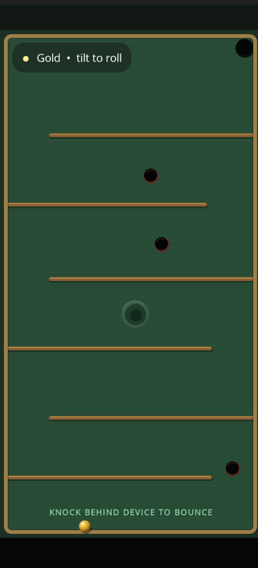

# RollingMaze

The rolling maze is a simple game where the player controls a ball that rolls through a maze. The goal is to reach the end of the maze while avoiding obstacles.
the Game rurns on the **MAUI** APP Main Screen. 
It is designed for phones, or tablets that support accelerometers not desktops.
It will run inside a SKiaSharp View that will fit the full window.
At the start of the game the user will be asked which type of ball they will use (wood, silver, gold ) each have different physics, slickness, weight, inertia... 

Work Balls with different physics work. 



## Maze files and designer

On the ball selection screen, lay the phone flat and tap **Calibrate tilt**. Keep it still for about two seconds until the saved confirmation appears. Calibration averages the resting sensor input and removes that offset in both Debug and Release builds. It is saved on this device for future launches; recalibrate if the phone's resting setup changes. Debug builds also provide the control in the tilt diagnostics panel. Movement or missing readings leave the previous calibration intact.

Run the calibration regression checks with `dotnet run --project tests/TiltCalibration.Checks`.

Debug builds start with the most recently modified `Resources/Raw/levels/level*.rollingmaze.json` source file, then play the remaining levels in numeric order. Rebuild after editing a maze to update the starting level. Release builds always start at level 001 and follow numeric order.

To investigate tilt differences on a phone, choose a ball and open **Tilt diagnostics (Debug)**. The readout shows vertical input, tilt acceleration, the dip/black-hole contribution, and vertical speed before collisions (positive means down). Enable **Ignore black-hole and dip forces** to compare opposite steady tilts in an open area, away from walls and holes. Toggling it stops the ball for a fresh comparison; closing diagnostics restores maze forces. These controls are absent from Release builds.

While the diagnostic panel is open, samples are also logged five times per second under `RollingMazeTilt` (Android logcat, or debugger output on other platforms). Capture only these samples with `adb logcat -s RollingMazeTilt:I '*:S'`. Each sample includes the vertical input, tilt and maze acceleration, velocity before speed limiting/collisions, position, physics timestep, display rotation, and whether maze forces are disabled.

`RollingMaze.Mazes` contains the shared, versioned maze format. The first maze is still hardcoded; later mazes can be loaded from independent `.rollingmaze.json` files. See [the file-format specification](docs/maze-file-format.md) and the bundled `maze2.rollingmaze.json` example.

`MazeDesigner` is a separate Windows WPF application. Run it with:

```powershell
dotnet run --project MazeDesigner
```

Choose **Draw wall** and drag on the board, or select a placement tool and click. In **Select / move** mode, drag existing items and use **Delete selected** when needed. The saved files use the exact parser consumed by RollingMaze.
